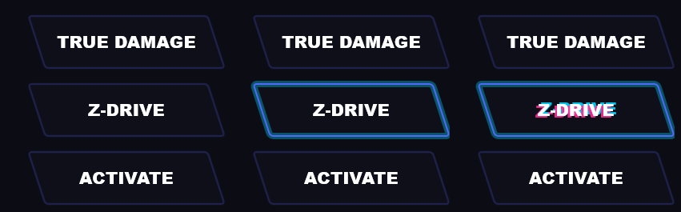

# Ekko Theme · Rainmeter 皮肤

以《英雄联盟》真实伤害 艾克 (True Damage Ekko) 为主题的 Rainmeter 皮肤集合。



## 目录结构

```
skin/
├─ WPE_dock.ini                     Wallpaper Engine 托盘控制条
├─ Visualizer/Visualizer.ini        音频频谱可视化
└─ Damage_Buttons/
   ├─ Damage_Buttons.ini            邪典霓虹故障按钮 (新)
   └─ preview.png                   三态预览: 静息 / 悬停 / 点击
@Resource/                          皮肤引用的图标与图片
```

## 安装

把本仓库放到 Rainmeter 皮肤目录下, 目录名保持 `Ekko_theme`:

```
%USERPROFILE%\Documents\Rainmeter\Skins\Ekko_theme\
```

然后在 Rainmeter 中右键托盘图标 → 皮肤 → Ekko_theme → 选择要加载的 ini。

## True Damage 按钮组件

三个斜切霓虹按钮, 悬停有独立呼吸发光, 点击有 RGB 错位故障特效。

| 状态 | 效果 |
| --- | --- |
| 静息 | 深色底 + 紫色细描边 + 青色微弱光晕 |
| 悬停 | 描边提亮至满强度, 光晕加粗加亮 (每个按钮独立, 互不干扰) |
| 点击 | 文字出现青色/粉色错位故障, 约 270ms |

### 自定义

打开 `skin/Damage_Buttons/Damage_Buttons.ini`, 修改 `[Variables]`:

```ini
Btn1Text=TRUE DAMAGE          ; 按钮文字
Btn2Text=Z-DRIVE
Btn3Text=ACTIVATE

Btn1Cmd=["explorer.exe" "#SKINSPATH#Ekko_theme\wallpaper"]   ; 点击动作
Btn2Cmd=["explorer.exe" "#SKINSPATH#Ekko_theme\media"]
Btn3Cmd=["explorer.exe" "#SKINSPATH#Ekko_theme\skin"]
```

`Btn*Cmd` 换成自己的程序路径即可, 例如 `["C:\Program Files\App\app.exe"]`。

其余可调项: `BtnW` `BtnH` `Skew`(斜切角度) `Gap`(行距) `PadX` `PadY`,
以及配色 `NeonPink` `NeonPurple` `NeonCyan` `DarkBg`。

> 注意: 修改 `BtnW` / `Skew` / `BtnH` 时, 需要同步调整 `BtnBodyX` / `BtnBodyW`
> (关系为 `BtnBodyW = BtnW - Skew*2`, `BtnBodyX = Skew`)。

## 关于大体积素材

`media/` `wallpaper/` `ekkotheme/` 与根目录的 `.webm` / `.mov` 片段约 2GB,
已列入 `.gitignore`, 不随仓库分发 (GitHub 单文件上限 100MB)。
需要版本管理时请改用 Git LFS 或自行托管。

## 环境

在 Rainmeter 4.5.28 (64-bit) / Windows 10 上测试通过, 日志无错误。